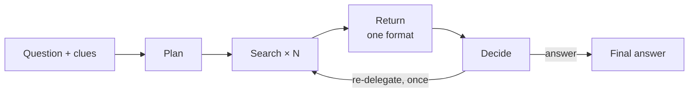
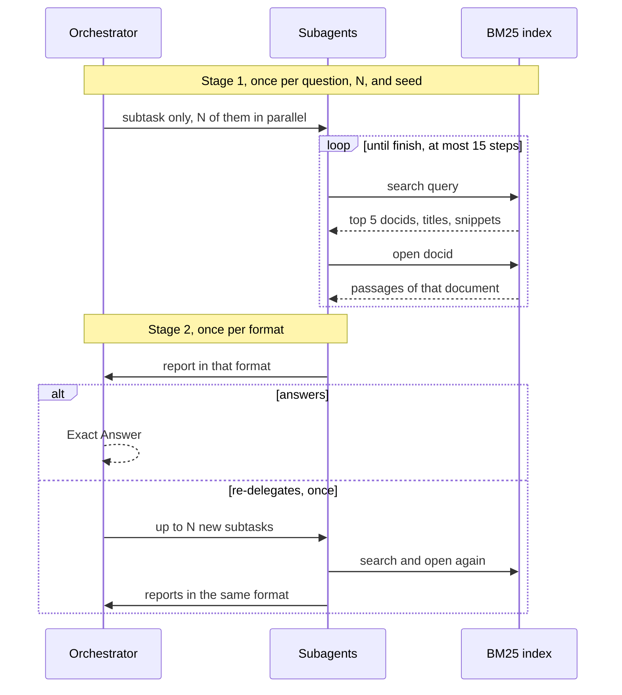

# Harness architecture

Short version of [`harness-design.md`](harness-design.md). The study question is assumed known: does a smaller or differently shaped subagent report keep accuracy while cutting tokens?

The harness is our own loop. It runs one BrowseComp-Plus question under one configuration (report format × N × seed) and records every model call.

## Library

Not LangChain, AutoGen, CrewAI, or SWE-agent. Those frameworks own the agent loop, the prompts, and usually the tool protocol. Here the loop is the experiment: what a subagent sends back, and what that costs. A framework would hide both.

| Piece | Library | Why |
| --- | --- | --- |
| Model calls | OpenAI Python SDK (`AsyncOpenAI`, Chat Completions) | One protocol for vLLM, hosted APIs, OpenAI, and Ollama. The server's usage object is the token count. |
| Config and records | `pydantic` | A bad config fails at load. |
| Token counts the server does not give | `tiktoken`, Hugging Face `tokenizers` | Report size, and reasoning tokens when a server omits them. |
| Search | BrowseComp-Plus `BM25Searcher` (`pyserini`, Java 21) | Their search and get_document tools on the released index. |

## How a run is shaped



Two stages:

- **Stage 1, shared.** Plan and the first-round searches. Run once per question, N, and seed, then reused by all six formats. The format is not in the prompt yet, so it cannot change what gets retrieved.
- **Stage 2, per format.** The return, the orchestrator's decision, and at most one extra round of subagents. This is the only place the format exists.

N = 1 skips the planner. The subtask is the question.

### Interactions

The subagents run in parallel and never see each other. The only tools are `search` and `open` on the BM25 index. The dashed return is the one allowed re-delegation. Stage 1 is cached and reused for every format, so the `search` and `open` calls happen once.



## One question

Configuration: N = 3, format = quotes. The question asks which years an author worked as a probation officer. Five clues are already listed.

**Plan.** One orchestrator call. It splits the clues into three subtasks. Nothing about quotes is in this call.

**Search.** Three subagents, in parallel. Each sees only its subtask. Thinking is on. One JSON action per turn, up to 15:

```json
{"action": "search", "query": "Walibora probation officer"}
{"action": "open", "docid": "62014", "offset": 0}
{"action": "finish", "status": "found", "key_passages": ["62014#p4"]}
```

`search` is BM25 and returns the top 5 titles and snippets. `open` returns passages of that document. A finish before any search is rejected.

**Return.** Quotes copies the flagged passages. No model call. A summary format would add one writing turn here, with thinking off, and the format instructions would appear for the first time. The same searches are then reused for the other five formats.

```text
<report subagent="2" status="found">
<subtask>Find the years he was a probation officer.</subtask>
[62014#p4] He served as a probation officer from 1988 to 1996.
</report>
```

**Decide.** The orchestrator reads the three reports and either answers or sends up to three new subtasks. The answer is rendered for the BrowseComp judge:

```text
Explanation: Document 62014 states the years.
Exact Answer: 1988-96
Confidence: 80%
```

## Design choices

| Choice | Decision | Why it is this way |
| --- | --- | --- |
| Actions | JSON in the reply text, not native tool calls | The same parser works on every backend. Switch if the single-agent baseline lands far below published accuracy. |
| What a subagent sees | Its subtask only | The split is the thing under test. |
| When the format appears | The writing turn, after search | Otherwise the format changes the search, and the comparison is confounded. |
| Stage 1 | Cached and shared | Same evidence in, different report out. About six times cheaper than searching once per format. |
| Thinking | On during search. Off for the writing turn (lowest setting on gpt-oss, which cannot fully turn it off) | The writing turn is compression. Thinking there spends the tokens the study is measuring. |
| A subagent that fails | The whole question fails and is rerun | Dropping to N−1 would bias the comparison. |
| Durability | One gzipped JSON file per question. A rerun skips files that exist | A run can stop and continue. |
| Return size | Caps: short 200, medium 1,000, long 3,000, claims 800, quotes 2,000, raw 8,000 | This is the independent variable. Calibration can move the caps. |
| Claims citations | Only passages the subagent opened. Status comes from the search, not the model | A model will invent passage IDs, and the orchestrator will trust them. |

## Metrics

Every model call stores role, phase, round, subagent, input tokens, output tokens (reasoning included), cached input tokens, and reasoning tokens. Each of cached and reasoning is marked reported, estimated, or missing.

Per question those calls sum into:

| Bucket | What it counts |
| --- | --- |
| `plan`, `search`, `write`, `decide` | Round 1 only |
| `extra_rounds` | Everything in round 2 |
| `return_size` | Tokens in the reports the orchestrator read. Counted text, not a model call |
| `total` | All calls. The phase buckets add up to it |

After grading, per configuration:

- Accuracy, from the official BrowseComp judge.
- Output and input tokens per correct answer.
- Evidence recall at three points: retrieved, opened, and cited in the report.
- How often the orchestrator re-delegates, and how often a report hits its cap.

Each format is compared with the medium summary on the same questions. The target is accuracy within 2 points of medium, with at least 20% fewer output tokens. Cached tokens are stored and not used as a primary metric: they depend on which format ran first.

Module specs, record schemas, and tests are in [`harness-design.md`](harness-design.md).
