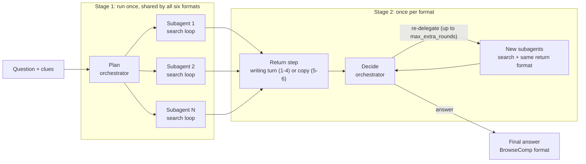

# Agent Harness Design

Oct 17, 2026 · Covers tasks B1 to B11 and the harness side of C1 to C7 in `tasks.md` · Updated to match the first implementation in `harness/`

## 1. What the harness does

The harness runs one BrowseComp-Plus question through the orchestrator-and-subagents system under one configuration (return format × N × seed). It writes a result file with the final answer, what every subagent saw and sent back, and exact token counts for every model call, each tagged by phase.

Three requirements shape the design:

1. **Only the return changes between formats.** For a given question, N and seed, the plan and the first-round searches must be identical across all six formats. The harness runs them once, caches them (stage 1), and then branches per format (stage 2).
2. **Exact token counts by phase.** Every model call goes through one client that reads the server's usage report and tags the call with role, phase, round and subagent.
3. **Any model backend.** The harness speaks one protocol, the OpenAI-compatible Chat Completions API. Hosted providers and self-hosted GPU servers (vLLM, SGLang) both expose it, so switching backends means editing config, not code.

Out of scope for this design: running the model servers (A3). The tools around the harness (data download, clue extraction, grading, analysis and calibration) read its result files and are listed in section 4; `checklist.md` tracks their status.

## 2. How one question runs



1. **Plan** (orchestrator). Reads the question and its clue list from A4 and groups the clues into exactly N subtasks. Skipped when N = 1, where the single subtask is the whole question.
2. **Search** (N subagents in parallel). Each subagent sees only its subtask and runs a loop of `search`, `open` and `finish` actions against the BM25 index, up to a step limit. At `finish` it flags the passages it considers key. The search prompt is the same for every format; nothing about the return format is visible yet.
3. **Return** (once per format). Formats 1 to 4 add one writing turn to the subagent's conversation, with thinking off, where the format instructions first appear. Formats 5 and 6 make no model call: the harness copies the flagged passages or the opened documents. Every report goes into the same wrapper.
4. **Decide** (orchestrator). Reads all reports and either answers or re-delegates up to N new subtasks. Re-delegated subagents search and return in the same format. After `max_extra_rounds` the orchestrator must answer.
5. **Write the result.** One file per question and configuration.

Steps 1 and 2 are stage 1. Steps 3 to 5 are stage 2.

## 3. Model backends

### One protocol, many backends

Every model call uses the OpenAI Python SDK pointed at a `base_url`:

| Backend | How the harness reaches it | Check in A3 |
| --- | --- | --- |
| Self-hosted vLLM or SGLang on our own GPU | `base_url = "http://<host>:8000/v1"` | Start vLLM with `--enable-prompt-tokens-details` so cached tokens are reported, and with the model's reasoning parser so thinking text comes back separately |
| Hosted open-model providers (for example Together, Fireworks, DeepInfra, OpenRouter, Groq) | The provider's OpenAI-compatible URL and key | Which usage fields they fill (cached and reasoning tokens vary), and whether `seed` is honored |
| Closed-model APIs (OpenAI; Gemini and others through their OpenAI-compatible endpoints) | The provider's URL and key | Reasoning text is often hidden while reasoning tokens are still reported |
| Anything without an OpenAI-compatible API | A LiteLLM proxy in front of it | Nothing changes in the harness |

Each role (orchestrator, subagent, single-agent baseline) maps to a named endpoint. The orchestrator can run on a large model and the subagents on a small one, on different backends if needed.

### Endpoint config

```toml
# configs/endpoints.toml
[endpoints.gptoss-20b-vllm]
base_url = "http://gpu-node:8000/v1"
api_key_env = "VLLM_API_KEY"          # name of the env var, never the key itself
model = "openai/gpt-oss-20b"
tokenizer = "hf:openai/gpt-oss-20b"   # or "tiktoken:o200k_base" for closed models
context_window = 131072
max_concurrency = 32                  # requests in flight to this endpoint
timeout_s = 600
max_retries = 5                       # retries after the first attempt
max_tokens_param = "max_tokens"       # some APIs require "max_completion_tokens"
sampling = { temperature = 1.0, top_p = 1.0 }
thinking_on = { reasoning_effort = "medium" }
thinking_off = { reasoning_effort = "low" }    # gpt-oss has no full "off"

[endpoints.qwen35-27b-hosted]
base_url = "https://api.provider.example/v1"
api_key_env = "PROVIDER_API_KEY"
model = "Qwen/Qwen3.5-27B"
tokenizer = "hf:Qwen/Qwen3.5-27B"
context_window = 131072
max_concurrency = 16
timeout_s = 600
max_tokens_param = "max_tokens"
sampling = { temperature = 0.6, top_p = 0.95 }
thinking_on = { extra_body = { chat_template_kwargs = { enable_thinking = true } } }
thinking_off = { extra_body = { chat_template_kwargs = { enable_thinking = false } } }
```

`sampling`, `thinking_on` and `thinking_off` are passed into the request as they are, so model-specific settings live in config rather than in code. A nested `extra_body` table is flattened into the request body, so settings written for the OpenAI SDK's `extra_body` work unchanged. Only the defaults are optional (`api_key_env`, `context_window`, `max_concurrency`, `timeout_s`, `max_retries`, `max_tokens_param`); unknown keys outside those three tables are rejected, so a typo fails at load time.

### Usage normalization

Each response's usage report is mapped to one record:

| Field | Read from | If missing |
| --- | --- | --- |
| `input_tokens` | `usage.prompt_tokens` | The call fails loudly. The smoke test catches this before any run. |
| `output_tokens` | `usage.completion_tokens` (includes reasoning) | Same |
| `cached_input_tokens` | `usage.prompt_tokens_details.cached_tokens` | Stored as null and marked "not reported" |
| `reasoning_tokens` | `usage.completion_tokens_details.reasoning_tokens` | Count the returned reasoning text (`reasoning_content`, or `reasoning` on some servers) with the endpoint's tokenizer and mark it "estimated"; null if there is no reasoning text either. A reported 0 alongside non-empty reasoning text is treated as missing. |

Visible output tokens are `output_tokens - reasoning_tokens`.

### Endpoint smoke test

`python -m harness.smoke configs/endpoints.toml <endpoint> > runs/<run>/smoke-<endpoint>.json` runs before any endpoint is used, and its JSON report is kept in the run folder:

1. A plain call returns input and output token counts.
2. The same long prompt sent twice: is cached input reported on the second call?
3. Thinking on and then off: does the reasoning count change, and is it reported or estimated?
4. The same seed twice at the configured temperature: is the output identical?
5. The local token count of a prompt against the reported input count. The gap is chat-template overhead; a large or varying gap means the `tokenizer` setting is wrong.

### If we deploy on our own GPU

Nothing in the harness changes; the serving side provides a `base_url`. Every call also records start and end timestamps. The token-based analysis ignores them, but if the team later gets a dedicated GPU and wants latency back, the data is already in the traces. Valid timing would still need the light-load runs from the proposal (a low `max_concurrency`).

## 4. Module specs

Python 3.11 or newer, with asyncio. Dependencies: `openai` (v3, built on `httpx2`), `pydantic` for validating config and records, `tokenizers` and `tiktoken` for counting, `pyserini` as an optional extra for the official BM25 index (needs Java 21), `huggingface_hub` and `pyarrow` for the download, `matplotlib` for the plots, and `pytest`. `requirements.lock` pins the tested versions. Config files are TOML, read with the standard library's `tomllib`. Records are pydantic models written as gzipped JSON.

```
harness/
  config.py        # TOML into validated models; the stage-1 key
  records.py       # CallRecord, Trajectory, Report, Plan, Stage1, Round, QuestionResult
  llm.py           # ModelClient: requests, usage normalization, retries, concurrency
  tokens.py        # load a tokenizer by name; count and truncate
  parsing.py       # the first JSON object in a reply; confidence values
  search.py        # corpus, passages, BM25 (Pyserini or in memory), per-subagent SearchSession
  planner.py
  subagent.py      # search loop and action parsing
  formats.py       # the six return formats and the report wrapper
  orchestrator.py  # decide: answer or re-delegate; context trimming
  pipeline.py      # one question: stage 1 (cached), then stage 2 per format
  accounting.py    # token sums by phase
  run.py           # CLI: grid runs, resume, shards
  check.py         # invariant checks on a finished run
  smoke.py         # endpoint smoke test
  data.py          # download and decrypt BrowseComp-Plus and the released runs into data/ (A2)
  clues.py         # clue extraction, its hand-check sample and clue-count chart (A4)
  grade.py         # official judge prompt, hand-check sample, export to the BrowseComp-Plus run format (D1)
  analyze.py       # evidence recall, per-configuration metrics, paired tests, plots (D2, D3)
  calibrate.py     # typical sizes from the released runs and our runs, suggested caps (C6)
  prompts.py       # load and render the templates; prompt version
  prompts.toml     # every prompt the harness models see (clue and judge prompts live in their modules)
configs/           # endpoints.toml (including the judges), pilot.toml
tests/             # offline tests, the mock server and the tiny-corpus fixture
docs/              # tasks.md, checklist.md and this design
proposal/          # the LaTeX proposal
data/  runs/       # gitignored
```

### 4.1 Config and records (B1)

```toml
# configs/pilot.toml
name = "pilot"
endpoints = "configs/endpoints.toml"  # or inline [endpoints.<name>] tables
questions = "data/questions.jsonl"   # {"qid", "question", "clues"} per line
clues = "data/clues.json"            # {qid: [clue, ...]} from A4, for questions without a clues field
corpus = "data/corpus.jsonl"         # {"docid", "title", "text"} per line
index = "data/bm25"                  # Pyserini index; without it, BM25 runs in memory
limit = 50
mode = "multi"                 # "single" for the E2 baseline
n_mode = "fixed"               # "free" for the E5 check
formats = ["short", "medium", "long", "claims", "quotes", "raw"]
n_values = [1, 3, 6]
seeds = [0]
max_questions_in_flight = 8

[roles]
orchestrator = "gptoss-120b-vllm"
subagent = "gptoss-20b-vllm"
single = "gptoss-120b-vllm"

[budgets]                      # return caps in tokens; C6 sets final values
short = 200
medium = 1000
long = 3000
claims = 800
quotes = 2000
raw = 8000

[limits]
max_steps = 15
max_invalid_streak = 3
max_extra_rounds = 1
search_k = 5
snippet_tokens = 512           # match the BrowseComp-Plus reference searcher
open_tokens = 1500
call_max_tokens = 8192         # output limit for search, plan and decide calls
writing_reasoning_allowance = 1024
```

- **Prompt version:** a short hash of `prompts.toml`, stored in every result.
- **Configuration key:** `(format, N, seed)`.
- **Stage-1 key:** a hash of everything that can change the plan or the round-1 searches: the question's ID, text and clues, N, seed, `n_mode`, the corpus and index paths, the orchestrator and subagent endpoint settings that shape a reply (URL, model, tokenizer, context window, sampling and thinking), the search limits and the prompt version. Format, budgets and `max_extra_rounds` are excluded because they only affect stage 2. Harness code is not part of the key, so a code change that affects search needs a new run name.
- **One config per run:** the run folder keeps `config.json`, and starting a run with different settings under the same name is refused. Operational settings (`limit`, `max_questions_in_flight`, API key variables, concurrency, timeouts, retries) may change between restarts.

Record layouts are in section 5.

### 4.2 Model client (B2, B7)

```python
class ModelClient:
    def __init__(self, endpoints: dict[str, Endpoint], http_client=None): ...
    async def chat(self, endpoint: str, messages: list[dict], tag: dict, *,
                   thinking: bool, max_tokens: int, seed: int | None = None) -> Completion: ...
```

`Completion` holds the visible text, the reasoning text if any, and the `CallRecord`. `tag` holds the role, phase, round, subagent and step. The question and configuration are not repeated in each call record, because every record is stored inside its question's result file.

- Builds each request from the endpoint config: model, sampling, `thinking_on` or `thinking_off`, the output limit under the endpoint's parameter name, and the seed. Everything except the model and messages is sent as `extra_body`, so provider-specific keys reach the server untouched.
- One semaphore per endpoint caps requests in flight at `max_concurrency`. This handles API rate limits and a GPU server's capacity the same way.
- Retries come from the OpenAI SDK: timeouts, connection errors, 408, 409, 429 and 5xx responses are retried up to `max_retries` times with exponential backoff and jitter, honoring `Retry-After`. Other errors are not retried. The SDK does not expose how many attempts a call took, so records do not count attempts.
- Raises after the last failed attempt. The question is marked failed and rerun later; the harness never continues with fewer subagents than planned.
- Records the response text, reasoning text, finish reason, normalized usage and timestamps.
- `http_client` is only for tests, which pass a client backed by the mock server.

A question's subagents run together in an `asyncio.TaskGroup`, so if one fails the others are cancelled instead of spending more tokens. A second semaphore caps questions in flight at `max_questions_in_flight`.

### 4.3 Search tool (B3)

The corpus is the BrowseComp-Plus document set with the official BM25 index, loaded through Pyserini when the config sets `index`. Without it, an in-memory BM25 with Pyserini's default parameters (k1 = 0.9, b = 0.4) scores every document, which is enough for the tests and small corpora. The document texts are loaded into memory either way, because `open` reads passages from them. Search settings (k, snippet length) start from the BrowseComp-Plus reference searcher so the single-agent baseline in E2 can be compared with published numbers.

**Passages.** Each document is split once at load time on blank lines. Short paragraphs are merged and long ones split at sentence ends, so each passage is roughly 80 to 250 words. IDs are `<docid>#p<k>` and stay the same for a given corpus.

Each subagent gets its own `SearchSession`:

| Action | Input | What the subagent sees |
| --- | --- | --- |
| `search` | query | The top k documents: docid, title and snippet |
| `open` | docid, optional offset | Passages from the offset onward, each prefixed with its ID, up to `open_tokens`; then a line such as "passages 0 to 7 of 23; open with offset=8 for more" |

The session records `retrieved` (docids shown in search results, in order), `opened` (docids opened) and `seen` (passage ID to text, for every passage shown through `open`). Only seen passages can be flagged or cited. An unknown docid or an offset past the end comes back as an invalid action.

### 4.4 Planner (B4)

Input: question, clue list and N. Output: JSON of the form `{"subtasks": [{"clues": [...], "task": "..."}]}`.

- **Fixed mode:** the prompt asks for exactly N subtasks. A wrong count gets one repair call that names the error. If the count is still wrong, the harness fixes it: with too many, it merges the two smallest subtasks until there are N; with too few, it splits the subtask with the most clues in half and writes its task text from the clue list.
- **Fewer clues than N:** the harness accepts one subtask per clue and records `actual_n`.
- **Free mode (E5):** the prompt allows 1 to N subtasks, and the count is recorded.
- Calls are tagged phase `plan`. N = 1 makes no call.

### 4.5 Subagent search loop (B5)

The conversation starts with a system prompt (role, actions, rules) and a user message holding the subtask. On each step the harness calls the model with thinking on, parses one action from the reply, runs it, and appends the result as the next user message. Earlier turns' reasoning is not sent back; only visible text stays in the conversation.

Actions are one JSON object per turn (see the decisions in section 8):

```json
{"action": "search", "query": "..."}
{"action": "open", "docid": "...", "offset": 0}
{"action": "finish", "status": "found | partial | not_found", "key_passages": ["d123#p4"]}
```

- The parser takes the first JSON object in the visible text, so prose and code fences around it are fine. Anything invalid (no JSON, unknown action, missing field, unknown docid) returns an error message as the observation and counts as an invalid step.
- At `max_steps` the harness sends "Step limit reached. Call finish now." If the reply is still not a valid `finish`, the subagent ends with no flagged passages and status `step_limit`.
- `max_invalid_streak` (3) invalid actions in a row end the search with status `invalid_actions`.
- If the next call would not fit (the last call's input and output, plus the newest observation, plus `call_max_tokens`, over the context window), the harness forces `finish` the same way; a reply that still is not `finish` ends with status `context_limit`.
- Flagged IDs the subagent never saw are dropped and counted.
- Every call is tagged phase `search`, including the forced-finish call.

The output is a `Trajectory`: the conversation, actions, observations, the session's retrieved, opened and seen records, the flagged passages, the status and the call records. Stage 1 caches this.

### 4.6 Return formats (C1 to C5, C7)

Common rules (C1):

- The format appears only in the writing turn, after `finish`. A test asserts that no format text appears in any search-phase message.
- Formats 1 to 4 append one writing turn to the subagent's own conversation, with thinking off, tagged phase `write`. Formats 5 and 6 make no model call and spend zero writing tokens.
- Citations are passage IDs in brackets, such as `[d123#p4]`.
- Sizes are counted with the orchestrator's tokenizer, since return size is what the orchestrator reads.
- Every format uses the same wrapper:

```text
<report subagent="2" status="partial">
<subtask>Find the year the bridge ...</subtask>
...content...
</report>
```

| # | Format | Model call | Content | Starting cap | If something goes wrong | Delivered docs (C7) |
| --- | --- | --- | --- | --- | --- | --- |
| 1 to 3 | Short, medium, long summary | Yes | Prose with citations | 200 / 1,000 / 3,000 | Over the cap: truncate at the cap and set `hit_cap` | Docs of cited passages |
| 4 | Structured claims | Yes | JSON following PACT: queries searched, claims each with evidence passage IDs, status | 800 | Invalid JSON: one repair call; still invalid, deliver the raw text with `valid = false` | Docs of evidence passages |
| 5 | Extracted quotes | No | Flagged passages in flag order, each with its ID | 2,000 | None flagged: use the seen passages that score highest against the subtask under BM25. Over the cap: drop from the end | Docs of included passages |
| 6 | Raw documents | No | Every passage the subagent opened, grouped by document in the order opened | 8,000 | Over the cap: drop from the end | Docs with any included text |

For summaries and claims, delivered docs come from citations, so they undercount evidence that a summary paraphrases without citing. C7 should note this when evidence recall is compared across formats.

For reasoning models the output limit covers thinking plus visible text. The writing call's limit is therefore the cap plus `writing_reasoning_allowance`, and the cap is enforced on the visible text afterward. `hit_cap` shows C2 how often the cap binds.

### 4.7 Orchestrator decision (B6)

The input is a system prompt, the question, the plan, and all reports so far. The conversation continues across rounds, so round 2 re-reads round 1's reports; prefix caching usually makes that cheap, but the input counts still include them.

The output is JSON, one of:

```json
{"decision": "answer", "explanation": "...", "exact_answer": "...", "confidence": 80}
{"decision": "redelegate", "subtasks": [{"task": "..."}]}
```

- Re-delegation allows up to N new subtasks. They run as fresh subagents with no memory of round 1, in the same format.
- In the last allowed round the prompt offers only `answer`.
- Invalid output gets one repair call. If it is still invalid, the harness records a failed decision with an empty answer, which grades as wrong and is flagged.
- The harness renders the answer in BrowseComp grading style: `Explanation: ...`, `Exact Answer: ...`, `Confidence: ...%`.
- If a round's reports would overflow the context window, the room left is split equally between the reports, and any report longer than its share is cut and flagged `trimmed`.
- Calls are tagged phase `decide`. Their input tokens are the orchestrator's reading tokens and their output tokens are the answer tokens.

**Single-agent mode (E2):** one agent runs the search loop on the full question, and its `finish` action carries the answer fields. There is no plan, return or decide step.

### 4.8 Pipeline and stage-1 cache (B8)

```python
async def run_unit(self, q, n, seed, retry_failed=False):    # Harness method; n is None in single-agent mode
    formats = shuffled(cfg.formats, seed=f"{qid}/{n}/{seed}")
    todo = [fmt for fmt in formats if no result yet and (retry_failed or no error file)]
    stage1 = await self.stage1(q, n, seed)                  # plan + round-1 trajectories, cached
    for fmt in todo:
        result = await self.stage2(q, fmt, stage1)          # reports, decide, extra rounds
        write_atomic(result_path(...), result)              # or an error file on failure
```

- Stage 1 is stored at `runs/<run>/stage1/<qid>-<stage-1 key>.json.gz` and reused when present.
- Each format's result includes the stage-1 call records, so per-question totals are complete for every configuration. For a "tokens actually spent" total, count the stage-1 files once instead of summing results.
- Format order is shuffled per question with a fixed seed, so prefix-cache warmth does not always favor the same format.

### 4.9 Token accounting (B9)

Each result's `tokens` block is built from its call records, and every bucket holds call, input, output, cached and reasoning counts:

- `plan`, `search`, `write`, `decide`: round-1 calls only.
- `extra_rounds`: every call in round 2 and later.
- `return_size`: the token count of each round-1 report (counted text, not a model call).
- `total`: the sum over all calls.
- `usage_gaps`: how many calls had no cached count, an estimated reasoning count, or no reasoning count at all.

Invariant: plan + search + write + decide + extra_rounds = total = the sum over call records. A call with an unknown phase fails the result rather than going uncounted, and `check` rebuilds every `tokens` block from the call records and compares. These buckets map directly onto the metrics table in `tasks.md`. Tokens per correct answer needs grades, so D3 computes it.

### 4.10 Runner (B10)

```
python -m harness.run configs/pilot.toml                # whole grid; skips finished questions
python -m harness.run configs/pilot.toml --limit 5      # first 5 questions
python -m harness.run configs/pilot.toml --shard 0/4    # every 4th question, starting at 0
python -m harness.run configs/pilot.toml --retry-failed
python -m harness.run configs/pilot.toml --runs-dir /scratch/runs
python -m harness.check runs/pilot                      # invariant checks (section 7)
```

- Results go to `runs/<run>/results/n<N>/s<seed>/<format>/<qid>.json.gz`, and single-agent results to `runs/<run>/results/single/s<seed>/<qid>.json.gz`. Each file is written to a temporary name and renamed, so a killed run never leaves a half-written result.
- A failure writes `<qid>.error.json` with the traceback and is skipped until `--retry-failed`. A success removes the error file.
- The run folder keeps `config.json` and the smoke-test reports. Every result stores the git commit and the prompt version.
- Shards let several processes, machines or API keys split the questions with no coordination, since every result is its own file.

## 5. Data contracts

The models are in `harness/records.py`. Each conversation is stored once, next to the calls made from it: the plan's in `plan.messages`, each subagent's in its trajectory, each writing turn in its report's `write_messages` (continuing the subagent's conversation), and the orchestrator's in `orchestrator_messages`. A call record stores how many of its conversation's messages were sent plus the reply, which avoids copying the whole conversation on every step.

**Call record**

```json
{
  "role": "subagent", "phase": "search", "round": 1, "subagent": 2, "step": 7,
  "endpoint": "gptoss-20b-vllm", "model": "openai/gpt-oss-20b", "messages_sent": 15,
  "input_tokens": 8123, "output_tokens": 412, "cached_input_tokens": 7680, "reasoning_tokens": 301,
  "usage_source": {"cached": "reported", "reasoning": "estimated"},
  "finish_reason": "stop", "t_start": 1760710000.12, "t_end": 1760710003.46,
  "response_text": "{\"action\": \"open\", \"docid\": \"d123\"}", "reasoning_text": "..."
}
```

**Question result** (abbreviated)

```json
{
  "qid": "123", "mode": "multi", "format": "quotes", "n": 3, "seed": 0,
  "stage1_key": "a1b2c3d4e5f6", "prompt_version": "9f8e7d6c", "git_commit": "5d71aff",
  "status": "ok",
  "plan": {"requested_n": 3, "actual_n": 3, "repaired": false, "fixed": false,
           "subtasks": [{"task": "...", "clues": [1, 4]}], "messages": ["..."], "calls": ["..."]},
  "rounds": [
    {
      "round": 1,
      "trajectories": [
        {"subagent": 1, "subtask": "...", "status": "found", "steps": 9, "invalid_steps": 0,
         "retrieved": ["d123", "d456"], "opened": ["d123"], "seen": {"d123#p4": "..."},
         "flagged": ["d123#p4"], "dropped_flags": 0, "messages": ["..."], "calls": ["..."]}
      ],
      "reports": [
        {"format": "quotes", "text": "<report ...>", "tokens": 1840, "content_tokens": 1815,
         "hit_cap": false, "valid": true, "trimmed": false, "delivered_docids": ["d123"],
         "write_messages": [], "calls": []}
      ],
      "decision": {"decision": "redelegate", "subtasks": [{"task": "..."}]}
    }
  ],
  "orchestrator_messages": ["..."], "orchestrator_calls": ["..."],
  "answer": {"decision": "answer", "explanation": "...", "exact_answer": "...", "confidence": 80,
             "response": "Explanation: ...\nExact Answer: ...\nConfidence: 80%"},
  "tokens": {
    "plan": {"calls": 1, "input": 900, "output": 350, "cached": 0, "reasoning": 210},
    "search": {"...": "..."}, "write": {"...": "..."}, "decide": {"...": "..."},
    "extra_rounds": {"...": "..."}, "total": {"...": "..."},
    "return_size": [1840, 1512, 2000],
    "usage_gaps": {"cached_not_reported": 0, "reasoning_estimated": 41, "reasoning_not_reported": 0}
  }
}
```

A failed decision has `"decision": "failed"` and an empty answer, which grades as wrong. In single-agent mode `format`, `n`, `stage1_key` and `plan` are null, and the one trajectory carries the answer.

## 6. Build steps

Each step is tested before the next starts. The mock backend arrives in step 2, so the agent work in steps 4 to 6 does not wait on the real endpoint or index.

| Step | Tasks | Build | Done when | Target |
| --- | --- | --- | --- | --- |
| 1 | A1, B1 | Repo layout, pinned environment, config loader, record dataclasses, tiny-corpus fixture | `pytest` runs, and a sample config loads and expands into its grid | Oct 20 |
| 2 | B2, B11, A3 | Model client with usage normalization, retries and concurrency; mock backend; smoke test | Client tests pass offline, and the smoke test passes on the chosen endpoint | Oct 22 |
| 3 | B3, A2 | Passages, BM25 search, `SearchSession` | Tiny-corpus tests pass, and a handful of real queries return sensible documents | Oct 22 |
| 4 | B5 | Subagent search loop and action parser | The mock model finishes a subtask on the tiny corpus; step-limit and invalid-action paths are tested; a person has read one real trajectory | Oct 25 |
| 5 | C1 to C5, C7 | The six formats and the wrapper | Golden tests pass on a fixed trajectory; caps hold; formats 5 and 6 make no calls | Oct 26 |
| 6 | B4, B6 | Planner, orchestrator and single-agent mode | Count repairs and the round cap are tested with the mock; one real question is answered end to end | Oct 27 |
| 7 | B8, B9, B10 | Stage-1 cache, accounting, runner, `check` | One question runs through all 18 configurations offline; stage 1 runs once; invariants hold; kill-and-resume works | Oct 28 |
| 8 | E1 | 5 real questions × 18 configurations | No errors, `check` passes, and return sizes fall in the expected range for each format | Oct 29 |

**Status (Oct 17):** the code for steps 1 to 7 is written and passes the offline tests. What remains of those steps needs real endpoints and data: pinning the environment, the smoke test on the chosen endpoint, real queries against the index, a person reading one real trajectory, and one real question end to end. Step 8 is next after that.

E2 (baseline) and E3 (pilot) follow before the mid-term. `tasks.md` allows B8 to slip past the mid-term. Without it, the pipeline reruns stage 1 for each format, which costs about six times the search tokens and loses the guarantee that all formats share the same searches, so B8 is worth keeping if at all possible.

## 7. Testing

### Offline tests

The default `pytest` run uses no network, spends no tokens, and takes a few seconds.

The mock backend (`tests/mock_llm.py`) is the real OpenAI SDK with an `httpx2.MockTransport`, so tests exercise the same request building, retries and response parsing as live runs. It recognizes each role from its prompt and plays it with a simple policy on a tiny corpus of 8 documents with one planted answer, `ZEBRA-42`. The planner deals clues round-robin; subagents search their subtask text, open the top two documents and flag their first passages; writers copy the passages they saw; and the orchestrator answers with a code found in the reports, or re-delegates. Tests can queue scripted replies or HTTP errors per role. Usage is word counts, and the tests count with a `words` tokenizer, so expected totals are known exactly. Options switch off cached or reported reasoning counts to imitate servers that report less.

| Module | What the tests check |
| --- | --- |
| Config | The shipped configs load. Roles must name endpoints, and typos are rejected. The stage-1 key changes with the question, N, seed, a model, sampling, a search limit or the prompt version, and not with format, budgets or operational settings. |
| Model client | Usage shaped like OpenAI, vLLM with and without prompt details, and a provider with no cached or reasoning fields all map to the right record and sources. Reasoning is estimated from text when not reported. Missing usage fails loudly. Request bodies merge config correctly. A 429 followed by a 200 succeeds after one retry and gives one record. A persistent 500 raises after the retries. Requests in flight never exceed `max_concurrency`. A missing API key variable is an error. |
| Search | Paragraphs merge and split into 80 to 250-word passages. Passage IDs are identical across two loads. Search is deterministic and finds the answer document. `open` respects the cap and pages correctly, and rejects unknown docids and bad offsets. Retrieved, opened and seen are recorded. |
| Planner | Too many, too few and malformed outputs are repaired, then fixed by merging or splitting. Malformed twice falls back to even clue groups. Fewer clues than N sets `actual_n`. Free mode accepts fewer subtasks. N = 1 makes no call. |
| Subagent loop | A valid run searches, opens and finishes. The step limit forces a finish, and so do three invalid actions in a row and a full context. A single invalid action gets feedback and the search continues. Unseen flagged IDs are dropped. JSON inside prose and code fences parses. Single-agent mode needs an answer to finish. |
| Formats | Quotes give golden output with no model call, and fall back to BM25 ranking when nothing is flagged. Raw groups by document in opened order. Summaries write with thinking off and are truncated at the cap. Claims are compacted, cited, trimmed from the end to fit, repaired once, and delivered raw and flagged if still invalid. Every format shares the wrapper and respects its cap. |
| Orchestrator | Both decision types parse; unusable replies raise. The last round rejects re-delegation. BrowseComp rendering is correct. Reports are trimmed to equal shares only when the context would overflow. One bad reply is repaired; two give a failed decision. |
| Pipeline, runner and check | One question runs through all 18 configurations and `check` passes. With N = 1 every format finds the answer. Stage 1 runs once per question, N and seed, counted as mock requests. No search-phase request contains a format prompt. The six formats share one stage-1 key and identical round-1 searches, and only written formats spend writing tokens. A finished run resumes with no requests. A changed config cannot reuse a run folder. Re-delegated calls land only in `extra_rounds`, the last round forces an answer, and phase sums match the call records. Failures write an error file, are skipped on rerun, and succeed with `--retry-failed`. An interrupted write leaves no result file. Single-agent mode answers. `check` catches tampered totals. |
| Smoke test | Against the mock, it reports token counts, cached tokens, reported or estimated reasoning, seed repeatability and template overhead. |

### Live tests

These are opt-in, because they spend tokens: `HARNESS_ENDPOINTS=configs/endpoints.toml HARNESS_ENDPOINT=<name> pytest -m live`. Only the first is automated so far.

1. The smoke test on each endpoint (section 3).
2. One real question in one configuration, with a person reading the full trace.
3. E1: 5 questions × 18 configurations.
4. Backend swap: the same 5 questions in one configuration on two backends, for example a hosted API and vLLM. The harness must run unchanged on both. Token counts will differ somewhat because providers apply chat templates differently, which is why a study never mixes backends.

### Invariant checks on every real run

`python -m harness.check runs/<run>` verifies that:

- Every result has a status, and every successful result has an answer.
- Phase sums match the total.
- Writing tokens are zero for formats 5 and 6 and nonzero for formats 1 to 4.
- Report sizes are at or under their caps.
- The six formats of the same question, N and seed share one stage-1 key and identical round-1 search records.
- Every call record has input and output tokens. It also reports the share of cached and reasoning counts that are estimated or missing.
- Failed questions are listed with their errors.

### Accuracy sanity check

E2 compares the single-agent baseline on 50 questions with the published BrowseComp-Plus accuracy for the same model and retriever. A large gap points at the search tool or the action protocol, and should be fixed before any multi-agent run.

## 8. Proposed defaults for open decisions

The harness needs an answer to each of these to start. Each is a proposal and can change through config or a prompt edit, except the action protocol, which touches the subagent loop.

| Decision | Proposed default | Why |
| --- | --- | --- |
| Action protocol (B5) | Plain JSON actions in the reply text | Works the same on every backend, with no dependence on each server's tool-call parser. Switch to native tool calling if E2 accuracy is well below published numbers, since published baselines use tool calling. |
| Subagent context (B5) | Subtask only | Keeps the split clean and matches how production systems brief subagents |
| Thinking (B9, C1) | On during search; lowest setting for the writing turn; reasoning tokens reported as their own category | gpt-oss cannot turn thinking fully off, so "off" means its lowest effort |
| Cached tokens (B9) | Count all input and report cached input separately | Cached counts also depend on run order, so they stay secondary |
| Size caps (C4, C5) | Quotes 2,000 and raw documents 8,000 tokens per report | Reaches past the long summary; six raw reports plus one extra round still fit a 128K context; C6 sets the final values |
| Re-delegation (B6) | One extra round | Two if the pilot shows many questions still unresolved after one |
| Model access (A3) | No effect on the harness | Any OpenAI-compatible endpoint works |
| N = 1 | No planner call | The only possible plan is the whole question |
| Invalid claims JSON (C3) | One repair call, then deliver the raw text flagged invalid | Keeps the information; analysis can exclude flagged reports |
| A subagent fails after retries | Fail the whole question and rerun it | Continuing with fewer subagents would bias the results |

## 9. Risks

| Risk | Mitigation |
| --- | --- |
| The same model on different providers gets different chat templates or hidden system prompts, so token counts differ | Pin one backend per study, record the endpoint on every call, and never mix backends within a comparison |
| Thinking counts against the output limit and can crowd out the visible return | The writing turn's limit is the cap plus a reasoning allowance, and the cap is enforced on visible text |
| Hosted APIs ignore seeds or vary their outputs | The stage-1 cache makes formats share identical searches regardless; repeats use different seeds |
| Cached-token counts depend on which format ran first | Shuffle format order per question and treat cached tokens as secondary |
| Rate limits or a preempted GPU job interrupt a run | Per-endpoint concurrency caps, backoff, one file per question, and resume |
| Long returns at N = 6 plus an extra round approach the context window | Caps sized to fit, plus a trimming guard that flags any overflow |
| Pyserini needs Java 21 | Part of the A1 environment setup |
| Released traces contain decrypted questions | Keep `data/` and `runs/` out of git, and check the BrowseComp-Plus terms before the F5 release |

## 10. Not building now

- **Streaming and time-to-first-token:** not needed for token counts; add if latency comes back.
- **A tokens-per-minute rate limiter:** concurrency caps plus 429 backoff cover it.
- **A job queue or cluster scheduler:** shards plus one file per question cover several machines.
- **Dense retrieval:** the search session hides the retriever, so a dense index could replace BM25 later without touching the agents.
- **Native tool calling:** only if E2 calls for it.
- **Guided JSON decoding for claims:** only if the pilot shows many invalid outputs, and only if every backend in use supports it.
